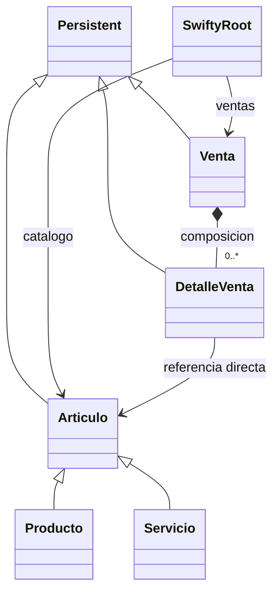

# Practica segunda unidad. Parte II

## Resumen de la actividad

Se eligieron el catálogo de productos y servicios, las ventas y sus detalles porque permiten mostrar una jerarquía de tipos y una relación de composición: una venta contiene sus partidas, y cada partida apunta directamente al artículo correspondiente.

El catálogo se representa con `Articulo` y sus subclases `Producto` y `Servicio`; `Venta` mantiene una colección persistente de `DetalleVenta`. La raíz de Durus administra el catálogo y las ventas para que el grafo se guarde mediante alcanzabilidad. También se añadieron operaciones CRUD, consultas que recorren ese grafo y una demostración de transacciones confirmadas y revertidas.

Se trabajó con `products`, `sales` y `sale_details`.

## Correspondencia relacional y de objetos

| Tabla Swifty | Clases persistentes | Representacion en Durus |
|---|---|---|
| `products` | `Articulo`, `Producto`, `Servicio` | La jerarquia conserva el campo `type` como despacho polimorfico. |
| `sales` | `Venta` | La venta mantiene sus partidas y calcula subtotal, impuesto y total. |
| `sale_details` | `DetalleVenta` | Cada partida referencia directamente un `Articulo` y guarda el precio historico. |

`client_id` y `client_type` permanecen como valores escalares porque las tablas de clientes no forman parte de estas tres entidades. Dentro del grafo implementado, las partidas referencian objetos `Articulo`, no claves de producto.

## Diagrama de clases



## Requisitos demostrados

1. **Clases persistentes:** `Articulo`, `Venta` y `DetalleVenta` heredan de `Persistent`; `Producto` y `Servicio` especializan `Articulo`.
2. **Encapsulamiento:** los datos se guardan en atributos protegidos y se cambian mediante metodos que validan texto, cantidades, importes, fechas y tasas.
3. **Herencia y polimorfismo:** `Producto` y `Servicio` sobrescriben `unidad_comercial()`. `DetalleVenta.resumen()` la invoca mediante la referencia al articulo, sin conocer la subclase.
4. **Objetos complejos:** `Venta` conserva partidas en `PersistentList`; cada `DetalleVenta` referencia su `Articulo` directamente. El precio unitario del detalle es una captura historica.
5. **Persistencia por alcanzabilidad:** `obtener_raiz(connection)` registra `SwiftyRoot` en `connection.get_root()["swifty"]`. Desde ahi se alcanzan catalogo, ventas, partidas y articulos.
6. **Transacciones:** `main.py` confirma una venta con `commit()` y despues crea otra que revierte con `abort()`. La prueba automatizada confirma que la segunda no queda en la raiz.
7. **Navegacion del grafo:** `ventas_de_cliente`, `ventas_con_articulo` y `resumen_venta` recorren referencias; cada funcion incluye su equivalente SQL como comentario.
8. **CRUD y cascada:** `SwiftyRoot` ofrece alta, consulta, modificacion y baja para articulos, ventas y partidas. No permite borrar un articulo usado; `baja_venta` elimina primero sus partidas compuestas.

## Instalacion y ejecucion

Desde este directorio, instala Durus en el entorno virtual activo:

```bash
python -m pip install -r requirements.txt
```

Desde la raiz del repositorio, ejecuta la demostracion:

```bash
python -m apicore.oodb.main --database /tmp/swifty-demo.durus
```

Ejecuta las pruebas desde `apicore/oodb`:

```bash
python -m unittest discover -s tests -v
```
